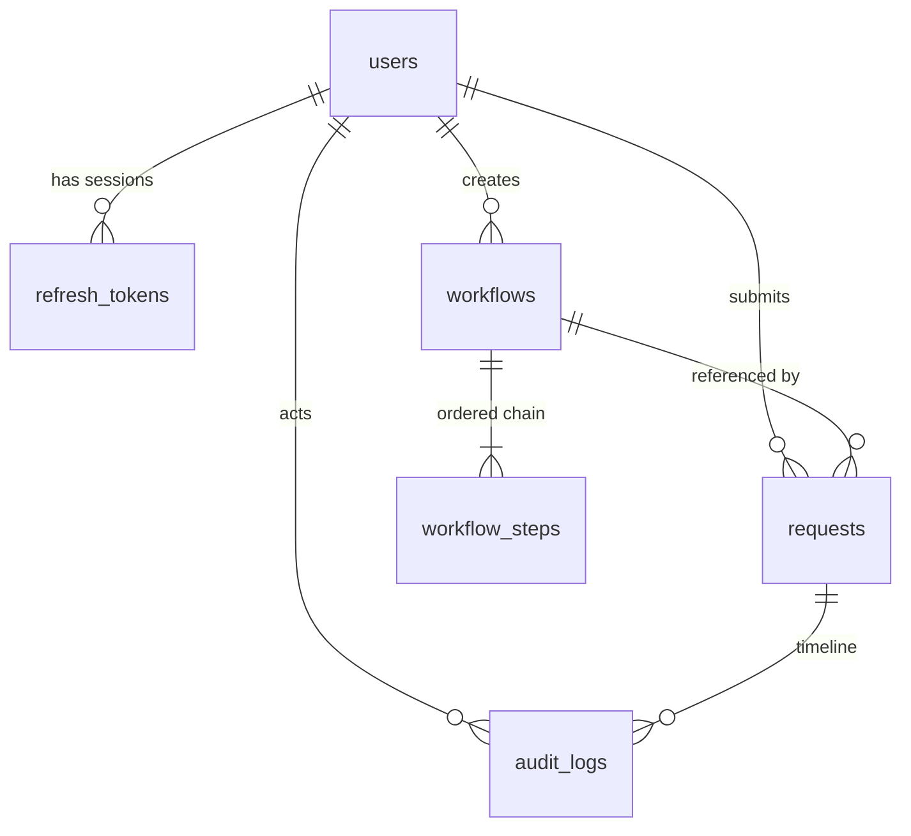

<div align="center">

# Configurable Approval Workflow

**Employees submit requests. Admins define the chain. Nothing is approved without a trace.**

A multi-step approval engine with a real state machine, server-enforced role permissions,
and an append-only audit trail — built as a working MVP, not a slide deck.

[](https://github.com/Sergiobb247/32-configurable-approval-workflow/actions/workflows/ci.yml)
[](#testing)
[](#quick-start)
[](https://fastapi.tiangolo.com)
[](https://react.dev)
[](https://www.postgresql.org)
[](#project-status)

[Quick start](#quick-start) · [Features](#features) · [Architecture](#architecture) · [API](#api-reference) · [Team](#team)

</div>

---

> **In development.** The backend is complete and tested: 23 endpoints, 139 tests, seeded demo data, CI on every pull request. The React dashboard is being built against the live API. This is a one-week MVP — the scope is deliberately narrow and the limitations are listed rather than hidden.

## Table of contents

- [The problem](#the-problem)
- [Project status](#project-status)
- [Features](#features)
- [Architecture](#architecture)
- [Data model](#data-model)
- [The rules](#the-rules)
- [Quick start](#quick-start)
- [Demo accounts](#demo-accounts)
- [API reference](#api-reference)
- [Configuration](#configuration)
- [Testing](#testing)
- [Deployment](#deployment)
- [Design decisions](#design-decisions)
- [Known limitations](#known-limitations)
- [Project structure](#project-structure)
- [Team](#team)
- [Disclosure and license](#disclosure-and-license)

---

## The problem

Small organisations approve spending over chat, and it fails in three specific ways.

| Failure | What it looks like | What fixes it here |
|---|---|---|
| **No defined path** | Nobody knows whose sign-off a ₦450,000 request needs, so the requester asks around and takes whoever answers first | Admin-configured workflow chains |
| **No order** | Finance approves before the manager has seen it — or the requester approves their own request | A role-checked state machine with self-approval blocked |
| **No record** | Months later nobody can reconstruct who approved what, when, or why | An append-only audit trail written in the same transaction as the change |

Each row maps to one of the three learning outcomes the brief names: state machines, authorisation, auditability. The product is small on purpose — the point is that those three are implemented *properly*, not that the app has many features.

---

## Project status

| Component | State |
|---|---|
| REST API — auth, users, workflows, requests, approvals, audit | ✅ Complete · 23 endpoints |
| State machine, permission rules, approval engine | ✅ Complete · exhaustively tested |
| Database schema, seed data, demo accounts | ✅ Complete · 6 tables, idempotent seeder |
| CI — pytest on every pull request | ✅ Complete |
| Deployment blueprint (Render + PostgreSQL) | ✅ Complete |
| React dashboard | 🚧 In progress |
| Public live demo | 🚧 Not yet deployed |

The API is fully usable today through its generated documentation at **`/docs`**.

---

## Features

**Requests** — create a draft with title, description, amount and workflow · submit it, which freezes the chain onto the request · cancel while still open · track progress step by step, with who acted and when.

**Approvals** — a role-scoped inbox that shows only what is waiting on *your* role · approve with an optional comment or reject with a mandatory one · rejection stops the chain immediately.

**Workflows (admin)** — named, ordered chains where each step requires a role · activate and deactivate · replace the whole ordered step list · editing a workflow never mutates a request already in flight.

**Users (admin)** — list accounts, change a role, deactivate an account · deactivation takes effect on that user's very next request.

**Audit** — every action recorded with actor, action, from-state, to-state, comment and timestamp · per-request timeline and a global admin feed · no update endpoint, no delete endpoint, for anyone.

---

## Architecture

```
┌──────────────────────────────────────────────────────────────┐
│  Browser   React + Vite + Tailwind            (in progress)  │
└──────────────────────────┬───────────────────────────────────┘
                           │  JSON over HTTPS · Bearer token
┌──────────────────────────▼───────────────────────────────────┐
│  FastAPI                                                      │
│                                                               │
│  routes/      auth · users · workflows · requests ·           │
│               approvals · audit              HTTP only        │
│  auth/        security · dependencies        who is calling   │
│  domain       state_machine · permissions    pure rules       │
│  services/    workflow_engine · audit        the work         │
│  data         models · schemas · database                     │
└──────────────────────────┬───────────────────────────────────┘
                           │  SQLAlchemy
                 ┌─────────▼──────────┐
                 │ SQLite   (local)   │
                 │ PostgreSQL (prod)  │
                 └────────────────────┘
```

**Imports point downward only.** Routes may import services and domain rules; nothing below imports anything above it. The state machine imports nothing from FastAPI or SQLAlchemy at all — it is plain Python, which is why it can be tested exhaustively in milliseconds.

### Two invariants the codebase enforces

| Invariant | Enforcement |
|---|---|
| **Only `services/workflow_engine.py` writes `request.status`** | Routes load and delegate; nothing else updates that column |
| **Only `services/audit.record()` writes `audit_logs`** | It flushes but never commits, so the status change and its audit row commit together or not at all |

Break either and the product's central promise — that the trail matches the data — stops being true.

---

## Data model



`users` identity and role · `refresh_tokens` hashed sessions · `workflows` and `workflow_steps` the configurable chains · `requests` the things being approved · `audit_logs` the append-only record.

**Enums** — `Role`: `EMPLOYEE` `MANAGER` `FINANCE` `ADMIN` · `RequestStatus`: `DRAFT` `PENDING` `APPROVED` `REJECTED` `CANCELLED` · `Action`: `SUBMIT` `APPROVE` `REJECT` `CANCEL`.

<details>
<summary><b>The snapshot rule and the version rule</b></summary>

<br>

**Snapshot.** When a request is submitted, the workflow's ordered chain is copied onto the request as JSON:

```json
[{"order": 1, "role": "MANAGER", "label": "Line manager"},
 {"order": 2, "role": "FINANCE", "label": "Finance review"},
 {"order": 3, "role": "MANAGER", "label": "Second manager sign-off"}]
```

The request then follows the chain it was born with. An admin editing a workflow affects new requests only — never one already mid-flight. The cost is duplicated data and no "requests currently at step 7" query; the benefit is that approvals cannot change underneath the people making them.

**Version.** Every request carries a `version` that every action increments. The engine re-reads the row before writing and returns `409` if it moved — which is what stops two approvers clicking at the same moment from both succeeding.

</details>

---

## The rules

### State machine

| From | Action | Who | To |
|---|---|---|---|
| `DRAFT` | `SUBMIT` | submitter | `PENDING` at step 1 |
| `DRAFT` | `CANCEL` | submitter | `CANCELLED` |
| `PENDING` | `APPROVE` | the role required by the current step, not the submitter | `PENDING` at the next step, or `APPROVED` on the last |
| `PENDING` | `REJECT` | same | `REJECTED` — chain stops |
| `PENDING` | `CANCEL` | submitter, or an admin | `CANCELLED` |
| terminal state | anything | — | illegal → `409` |

Anything not in this table returns **`409 Conflict`**. Malformed input is a different failure and returns **`422`**.

### Permissions

| Capability | Submitter | Approver on the current step | Admin | Anyone else |
|---|:---:|:---:|:---:|:---:|
| View the request | ✅ | ✅ | ✅ | ❌ |
| See it in an inbox | — | ✅ | ✅ | ❌ |
| Submit own request | ✅ | — | ❌ | ❌ |
| Cancel | ✅ own | — | ✅ any, audited | ❌ |
| Approve / reject | ❌ **self-approval** | ✅ | ❌ **no override** | ❌ |
| Configure workflows | ❌ | ❌ | ✅ | ❌ |
| Manage users | ❌ | ❌ | ✅ | ❌ |
| Read the audit trail | own requests | inbox requests | everything | ❌ |

Three rules are worth stating plainly, because they are the ones a sceptical reviewer tests:

- **Self-approval is impossible.** Enforced in the engine, not hidden in the interface.
- **An admin can never approve.** Admins configure the rules; they do not decide outcomes. They may cancel any request, recorded with them as the actor. Nobody in this system can manufacture an approval.
- **A user may act at most once per request.** This is what makes a chain containing the same role twice safe: `MANAGER → MANAGER → FINANCE` needs two different managers, not one manager clicking twice. Chains requiring an `ADMIN` step are refused at creation with `422`, because such a chain could never complete.

Every refusal returns a sentence a person can read: *"You cannot approve your own request"*, *"This request already moved to the next step"*, *"You have already acted on this request"*.

---

## Quick start

**Requires Python 3.12+.** No database to install — local development uses SQLite.

```bash
git clone https://github.com/Sergiobb247/32-configurable-approval-workflow.git
cd 32-configurable-approval-workflow/backend
python -m venv .venv && source .venv/bin/activate      # Windows: .venv\Scripts\activate
pip install -r requirements.txt
cp .env.example .env && python seed.py && uvicorn app.main:app --reload
```

Open **http://localhost:8000/docs** — every endpoint is usable from there with the demo accounts below.

<details>
<summary><b>Platform notes and troubleshooting</b></summary>

<br>

| Situation | Fix |
|---|---|
| Windows activation | `.venv\Scripts\activate` |
| `email-validator is not installed` | `pip install -r requirements.txt` again — it is in the file |
| Port 8000 already in use | `uvicorn app.main:app --reload --port 8001` |
| Want a clean database | `rm -f app.db && python seed.py` |
| `JWT_SECRET` missing outside development | expected: set it in `.env`, or generate one with `python -c "import secrets; print(secrets.token_urlsafe(48))"` |

</details>

---

## Demo accounts

`python seed.py` creates six synthetic accounts. The password for all of them is **`Password123!`** — demo-only credentials, never to be reused.

| Email | Name | Role |
|---|---|---|
| `admin@demo.io` | Chidi Eze | `ADMIN` |
| `manager1@demo.io` | Bola Ade | `MANAGER` |
| `manager2@demo.io` | Tunde Okafor | `MANAGER` |
| `finance@demo.io` | Ngozi Eze | `FINANCE` |
| `employee1@demo.io` | Ada Obi | `EMPLOYEE` |
| `employee2@demo.io` | Ibrahim Musa | `EMPLOYEE` |

**Seeded workflows** — *Expense approval (> ₦100,000)*: Manager → Finance → second Manager · *Small expense (≤ ₦100,000)*: Manager.

**Seeded requests**, so every screen has something honest to show:

| Request | Amount | State |
|---|---:|---|
| Laptop replacement | ₦450,000 | `PENDING` at step 2 — **waiting in finance's inbox** |
| Team lunch | ₦75,000 | `APPROVED` |
| Conference travel | ₦1,200,000 | `REJECTED` at step 1, with a comment |
| Monitor arm | ₦40,000 | `DRAFT` |

The seeder is idempotent: a second run exits with `already seeded`.

<details>
<summary><b>Suggested 7-step walkthrough</b></summary>

<br>

1. Sign in as **finance** — the laptop request sits in the inbox at step 2 — and approve it.
2. Sign in as **manager2** — it has arrived for the second manager step — and approve it. Status becomes `APPROVED`.
3. Sign in as **employee1** and open the request: three green steps, each naming its approver and time.
4. As the employee, try to approve your own request → `403`, *"You cannot approve your own request"*.
5. As the admin, try to approve anything → `403`, *"Admins configure workflows; they cannot approve requests"*.
6. Submit the `DRAFT` monitor request, then reject it as its manager with a comment and watch the chain stop.
7. Read the audit trail: every action, in order, with its comment.

</details>

---

## API reference

Base path `/`. JSON in, JSON out, `snake_case` throughout. Lists are `{"items": [...], "total": n}`. Timestamps are ISO-8601 UTC. Amounts are strings with exactly two decimals (`"450000.00"`). Authenticate with `Authorization: Bearer <access_token>`.

<details open>
<summary><b>All 23 endpoints</b></summary>

<br>

| # | Method | Path | Who | Purpose |
|---|---|---|---|---|
| 1 | `POST` | `/auth/register` | public | create an account (defaults to `EMPLOYEE`) |
| 2 | `POST` | `/auth/login` | public | token pair + user |
| 3 | `POST` | `/auth/refresh` | valid refresh token | rotate and return a new pair |
| 4 | `POST` | `/auth/logout` | logged in | revoke the presented refresh token |
| 5 | `GET` | `/auth/me` | logged in | live profile and role |
| 6 | `GET` | `/users` | admin | list accounts |
| 7 | `PATCH` | `/users/{user_id}` | admin | change role, activate or deactivate |
| 8 | `GET` | `/workflows` | logged in | active workflows |
| 9 | `POST` | `/workflows` | admin | create a workflow with steps |
| 10 | `GET` | `/workflows/{workflow_id}` | logged in | workflow with ordered steps |
| 11 | `PATCH` | `/workflows/{workflow_id}` | admin | rename, describe, activate, deactivate |
| 12 | `POST` | `/workflows/{workflow_id}/steps` | admin | replace the ordered step list |
| 13 | `POST` | `/requests` | logged in | create a draft |
| 14 | `POST` | `/requests/{id}/submit` | submitter | `DRAFT → PENDING` |
| 15 | `GET` | `/requests` | logged in | own requests (all, for an admin) |
| 16 | `GET` | `/requests/{id}` | per matrix | detail with step progress |
| 17 | `POST` | `/requests/{id}/cancel` | submitter or admin | withdraw |
| 18 | `GET` | `/inbox` | approver | requests waiting on my role |
| 19 | `POST` | `/requests/{id}/approve` | current-step approver | comment optional |
| 20 | `POST` | `/requests/{id}/reject` | current-step approver | comment **required** |
| 21 | `GET` | `/requests/{id}/audit` | per matrix | timeline, oldest first |
| 22 | `GET` | `/audit` | admin | global feed, newest first |
| 23 | `GET` | `/health` | public | liveness check |

Full request and response schemas are generated at `/docs` and `/redoc`.

</details>

<details>
<summary><b>Example: the whole approval cycle with curl</b></summary>

<br>

```bash
API=http://localhost:8000

# sign in and keep the token
TOKEN=$(curl -s -X POST $API/auth/login \
  -H 'content-type: application/json' \
  -d '{"email":"finance@demo.io","password":"Password123!"}' | jq -r .access_token)

# what is waiting on me?
curl -s $API/inbox -H "Authorization: Bearer $TOKEN" | jq '.items[] | {id, title, status}'

# approve it
curl -s -X POST $API/requests/1/approve \
  -H "Authorization: Bearer $TOKEN" \
  -H 'content-type: application/json' \
  -d '{"comment":"Within budget"}' | jq '{status, current_step_index}'

# the trail so far
curl -s $API/requests/1/audit -H "Authorization: Bearer $TOKEN" | jq '.items[] | {action, from_state, to_state}'
```

</details>

<details>
<summary><b>Status codes</b></summary>

<br>

| Code | Meaning | Example |
|---|---|---|
| `200` / `201` | success | an approval returns the updated request |
| `401` | not authenticated — missing, invalid or expired token | no `Authorization` header |
| `403` | authenticated but not allowed | wrong role, someone else's request, self-approval, admin approving |
| `404` | no such resource | `GET /requests/999` |
| `409` | wrong state, or the request moved underneath you | approving a rejected request; a stale `version` |
| `422` | malformed input | negative amount, blank rejection comment, a workflow with no steps |

`403` and `409` are deliberately distinct: *"you may not"* tells a user to stop, *"not any more"* tells them to refresh. Every error body is `{"detail": "a sentence a human can read"}`.

</details>

---

## Configuration

All configuration is read in exactly one place and every value comes from the environment. `.env.example` is committed; `.env` is not.

| Variable | Default | Required in production | Purpose |
|---|---|:---:|---|
| `DATABASE_URL` | `sqlite:///./app.db` | ✅ | connection string; `postgres://` is normalised to `postgresql://` |
| `JWT_SECRET` | development fallback | ✅ | access-token signing key; startup fails if missing outside development |
| `ACCESS_TOKEN_MINUTES` | `15` | — | access token lifetime |
| `REFRESH_TOKEN_DAYS` | `7` | — | refresh token lifetime |
| `CORS_ORIGINS` | `http://localhost:5173` | ✅ | comma-separated exact origins, never `*` |
| `ENV` | `development` | ✅ | `production` enables strict secret checking |

Frontend, when running the dashboard: `VITE_API_URL` (API base URL) and `VITE_USE_MOCKS` (build against local fixtures instead of the API).

### Authentication design

| Concern | Decision |
|---|---|
| Passwords | bcrypt, 8–72 characters, never logged and never returned |
| Access token | HS256 JWT, 15 minutes, carries user id and role |
| Refresh token | 48 random bytes, **stored as a sha256 hash**, 7 days, rotated on every use |
| Reuse | presenting a revoked or expired refresh token returns `401` |
| Role changes | read from the database on every request, never trusted from the token — deactivation and demotion apply immediately |
| Client | access token in memory, refresh token in `localStorage`, one silent refresh and retry on `401` |

The `localStorage` choice is a known trade-off: it is XSS-exposed where an httpOnly cookie would not be. It is documented as a limitation rather than presented as best practice.

---

## Testing

```bash
cd backend && python -m pytest -q
```

**139 tests, roughly 24 seconds**, against in-memory SQLite with a fresh schema per test. Users are created through real factories and tokens are obtained from the real login endpoint — nothing is faked, and authentication is never stubbed.

| Suite | Focus |
|---|---|
| `test_state_machine.py` | every state × action combination, not a sample of them |
| `test_permissions.py` | the permission matrix cell by cell, plus terminal states against every action |
| `test_approval_flow.py` | full chain, reject-stops-the-chain, wrong role, self-approval, admin-cannot-approve, stale version, cancel after decision, empty workflow, amount ≤ 0, inbox rules, step actors |
| `test_auth.py` | hashing, expiry, refresh rotation, revocation, deactivated users |
| `test_users.py` | admin-only guards, self-modification refusal, immediate effect of deactivation |
| `test_workflows.py` | chain validation, duplicate and non-contiguous order, `ADMIN`-step refusal, in-flight isolation |
| `test_audit.py` | written per action, ordered, rollback leaves no row, no update or delete route exists |
| `test_integration_happy_path.py` | the demo path end to end through HTTP |

**Not covered, and stated rather than omitted:** browser automation, load and performance, Postgres-versus-SQLite parity, and security penetration testing.

---

## Deployment

`render.yaml` provisions a free PostgreSQL database and the API together.

1. **Render** → New → Blueprint → select this repository. `JWT_SECRET` is generated automatically and `DATABASE_URL` is injected from the database.
2. Set **`CORS_ORIGINS`** to the exact frontend origin, for example `https://your-app.vercel.app` — never `*`.
3. **Seed the deployed database once:**
   ```bash
   cd backend && DATABASE_URL="<deployed connection string>" python seed.py
   ```
4. **Smoke test:**
   ```bash
   curl https://<api-host>/health
   curl -X POST https://<api-host>/auth/login -H 'content-type: application/json' \
     -d '{"email":"admin@demo.io","password":"Password123!"}'
   ```
5. **Frontend** on Vercel with `VITE_API_URL` pointing at the Render URL.

Tables are created from the models on startup, which is safe to repeat on every deploy.

---

## Design decisions

<details>
<summary><b>Nine trade-offs, and what each one cost</b></summary>

<br>

| Decision | Alternative rejected | Why | What it cost |
|---|---|---|---|
| Snapshot the chain onto the request | normalised `request_steps` table | editing a workflow must not change a request already in flight | duplicated data; no "requests at step 7" query |
| One module writes `status` | each route updates its own | impossible to produce an unaudited state change | one more layer of indirection |
| Audit written in the same transaction | a fire-and-forget log call | the trail cannot disagree with the data | longer transactions |
| State machine as pure functions | status logic inline in routes | exhaustively testable in milliseconds; two people can work on it independently | two files to keep aligned |
| Optimistic locking with `version` | pessimistic row locks | identical behaviour on SQLite and Postgres, no infrastructure | callers must handle `409` |
| No admin override on approvals | audited "break-glass" approval | keeps one claim true with no exceptions: nobody can manufacture an approval | a genuinely stuck request must be cancelled |
| `403` and `409` kept distinct | collapsing both into `400` | each produces a different, actionable message in the UI | discipline in every route |
| SQLite locally, PostgreSQL in production | one engine everywhere | nobody is blocked installing a database on day one | must avoid engine-specific SQL |
| No migrations tool | Alembic from day one | one schema version, no data to preserve | schema changes are manual |

</details>

---

## Known limitations

Deliberately out of scope for this sprint, listed honestly:

- **No migrations** — tables are created from the models at startup.
- **One role per user** — multiple roles would multiply the permission matrix.
- **No notifications** — nothing emails or messages an approver.
- **No amount-based routing** — chains are fixed per workflow, not conditional on the amount.
- **No parallel approvers, delegation or escalation.**
- **Refresh token in `localStorage`** rather than an httpOnly cookie.
- **No frontend automation** — browser paths are checked manually.
- **SQLite in tests, PostgreSQL in production** — engine differences are mitigated by portable types, not eliminated.

**Next steps** — amount-based routing rules · email notification when a request enters an inbox · a normalised `request_steps` table · Alembic migrations · refresh tokens in httpOnly cookies · Playwright coverage of the dashboard · metrics and tracing.

---

## Project structure

<details>
<summary><b>Expand the tree</b></summary>

<br>

```
approval-workflow/
├── backend/
│   ├── app/
│   │   ├── main.py                 app factory, CORS, error handlers, routers
│   │   ├── config.py               the only place environment variables are read
│   │   ├── database.py             engine, session, declarative base
│   │   ├── models/                 six tables and the enums
│   │   ├── schemas/                Pydantic request and response shapes
│   │   ├── auth/                   password hashing, tokens, dependencies
│   │   ├── state_machine.py        pure transition table and two functions
│   │   ├── permissions.py          pure rules: may this user act on this request
│   │   ├── services/
│   │   │   ├── workflow_engine.py  the only writer of request.status
│   │   │   └── audit.py            the only writer of audit_logs
│   │   └── routes/                 auth · users · workflows · requests · approvals · audit
│   ├── tests/                      eight suites, shared fixtures and factories
│   ├── seed.py                     idempotent demo data
│   ├── requirements.txt
│   └── .env.example
├── frontend/                       React + Vite dashboard (in progress)
├── .github/workflows/ci.yml        pytest + frontend build on every pull request
└── render.yaml                     Render blueprint for the API and database
```

</details>

---

## Team

Five people, each owning a slice of the system end to end. Every file has exactly one owner; changes land on `develop` through reviewed pull requests, and `main` only receives release merges.

| Person | Name | Owned |
|---|---|---|
| A | **Gogo Frank** | config, database, authentication, tokens, admin user management |
| B | **Saviour Menebari Peba** | data model, schemas, state machine, test fixtures |
| C | **Eze Chebem** | permission rules, approval engine, request and approval routes |
| D | **Moses Abigail** | workflow endpoints, audit service and reads, app shell, seed data, CI, deployment |
| E | **Damiebi William-West** | React dashboard |

**Stack** — FastAPI · SQLAlchemy 2.0 · Pydantic v2 · PostgreSQL · JWT + bcrypt · pytest · React 18 · Vite · Tailwind CSS v4 · GitHub Actions.

---

## Disclosure and license

Libraries used: FastAPI, SQLAlchemy, Pydantic, Uvicorn, PyJWT, bcrypt, passlib, psycopg2-binary, email-validator, pytest, httpx; React, Vite, Tailwind CSS and React Router on the frontend. No starter template or third-party application code was used.

All data is **synthetic**: invented names, invented amounts, no real personal or financial information anywhere in this repository or the demo. Demo passwords are published on purpose so reviewers can sign in, and are documented as demo-only.

Built as a project deliverable; no license is granted for reuse.

<div align="center">
<br>
<sub>Built in one week by a team of five · <a href="#configurable-approval-workflow">back to top</a></sub>
</div>
