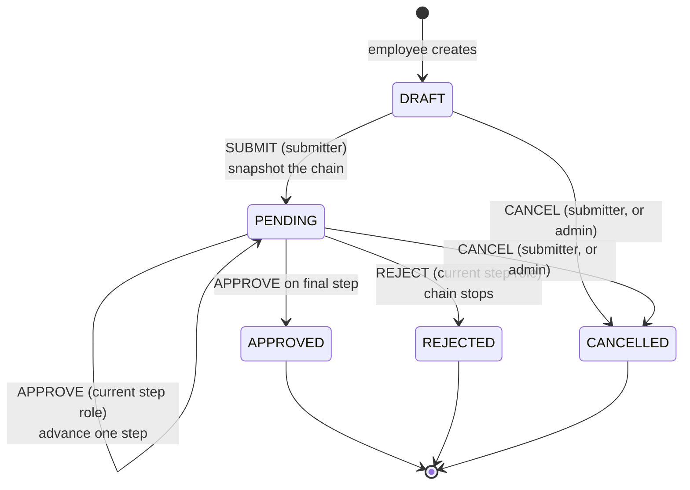
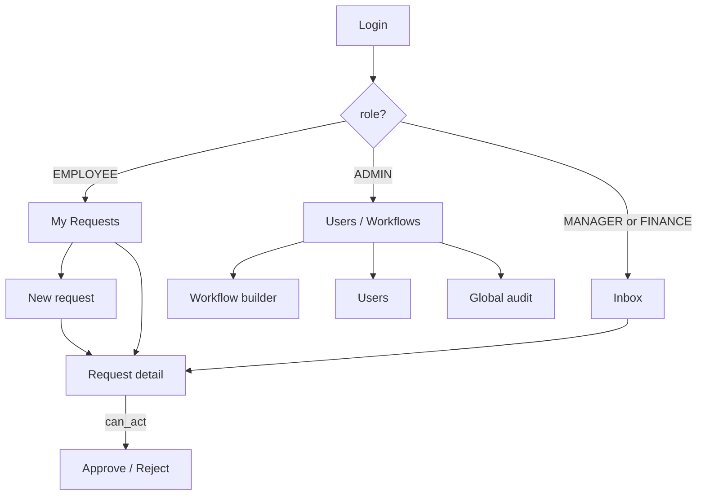

# App Flow — Configurable Approval Workflow

> **Status:** frozen end of Day 1.
> **Owner:** derived from `prd.md` by Person E, reviewed by all.
> **Purpose:** one page that keeps five people building the same product. If a screen or a state is not on this page, it does not exist.

---

## 1. Request lifecycle (the state machine)



**Every arrow that is not drawn is illegal** and returns `409`. That is the entire state machine — five states, four actions, and one rule: terminals stay terminal.

Worked example, "Expense approval (> ₦100,000)" with steps `MANAGER → FINANCE`:

```
DRAFT ──submit──▸ PENDING(step 1, MANAGER) ──approve──▸ PENDING(step 2, FINANCE)
      ──approve──▸ APPROVED
```

Reject at any point: `─reject──▸ REJECTED`, and steps after it never happen.

---

## 2. Roles and their paths through the app



The employee never sees an inbox. Managers and Finance users see the approval inbox when a request reaches their role. The admin sees configuration first and does not approve requests. Everyone shares the same request-detail screen — it adapts from `can_act`.

---

## 3. Screen map

Six screens. No more. This is the whole UI.

| Screen | Who lands here | Reads | Writes | Owner |
|---|---|---|---|---|
| **Login** | everyone, unauthenticated | — | `POST /auth/login` | E |
| **My Requests** | employee, manager, finance | `GET /requests` | `POST /requests`, `/submit`, `/cancel` | E |
| **Inbox** | manager, finance | `GET /inbox` | — | E |
| **Request Detail** | anyone who may view | `GET /requests/{id}`, `GET /requests/{id}/audit` | `POST /approve`, `/reject`, `/submit`, `/cancel` | E |
| **Workflow Builder** | admin | `GET /workflows` | `POST /workflows`, `POST /workflows/{id}/steps`, `PATCH /workflows/{id}` | E |
| **Users** | admin | `GET /users` | `PATCH /users/{id}` | E |

Plus a header on every authenticated screen: the user's name, role chip, **Sign out**.

---

## 4. The main flow, end to end

The demo path. If all of this works, the product works.

```
1. ADMIN       logs in → Workflow Builder → creates "Manager → Finance"
2. EMPLOYEE    logs in → New request (₦450,000) → Submit
                   request: status PENDING, current_step_index 0, chain snapshotted
3. MANAGER     logs in → Inbox (1 item) → opens it → Approve ("within budget")
                   request: PENDING, current_step_index 1
                   audit: SUBMITTED, APPROVED
4. FINANCE     logs in → Inbox (1 item) → opens it → Approve
                   request: APPROVED, decided_at set
5. EMPLOYEE    opens it → sees both completed steps and the full trail
6. ADMIN       opens global audit → sees the recorded workflow and request events
```

Screens touched by more than one role: **Request Detail**. Design it once, drive it from data, not from role checks.

---

## 5. Failure paths worth drawing

Each of these is a demo beat and a test case. They are the reason the app looks trustworthy.

| # | Situation | What the user sees | Code |
|---|---|---|---|
| 1 | Employee tries to approve their own request | "You cannot approve your own request" | `403` |
| 2 | Manager opens a request waiting on Finance | not in their inbox; direct URL → "This request is waiting on another role" | `403` |
| 3 | Two approvers act at once | second gets "This request already moved on", page refreshes | `409` |
| 4 | Approve after rejection | "This request has already been decided" | `409` |
| 5 | Reject without a comment | inline field error, not a toast | `422` |
| 6 | Amount `0` or negative | inline field error on the form | `422` |
| 7 | Access token expired | one silent refresh, request retries, user notices nothing | `401` → refresh |
| 8 | Refresh token revoked | redirected to Login with "Please sign in again" | `401` |
| 9 | Empty inbox | "Nothing waiting for you" with a short explanation | `200` |
| 10 | Admin edits a workflow mid-flight | in-flight request untouched, new requests use the new chain | `200` |
| 11 | The same person tries to approve twice on one request | "You have already acted on this request" | `403` |
| 12 | Admin tries to approve a pending request | "Admins configure workflows; they cannot approve requests" | `403` |

---

## 6. Navigation and guards

```
/                 → redirect by role (employee → /requests, approver → /inbox, admin → /workflows)
/login            → public; if already signed in, redirect to /
/requests         → My Requests            (any authenticated user)
/requests/new     → New request form       (any authenticated user)
/requests/:id     → Request Detail         (any authenticated user; server decides visibility)
/inbox            → Inbox                  (MANAGER, FINANCE)
/workflows        → Workflow Builder       (ADMIN)
/users            → Users                  (ADMIN)
```

`Authenticated route guards` handle "not signed in" and "wrong role". **The server enforces the same rules** — the guard is a convenience, the API is the authority. Admins are not approvers even if they open a request directly.

---

## 7. What the UI must never do

- Compute the approval decision client-side as the only check
- Hide the audit trail from people entitled to see it
- Show a raw stack trace, a blank screen, or a spinner that never stops
- Present a mocked screen as finished (rubric rule, and a bad habit)
- Invent a seventh screen without removing one

---

## 8. Change control

This file changes only when the **product** changes. A screen added, a state added, or a role gaining a capability is a PR to this file reviewed by all five. Cosmetic changes are not changes to the flow and do not come here.
